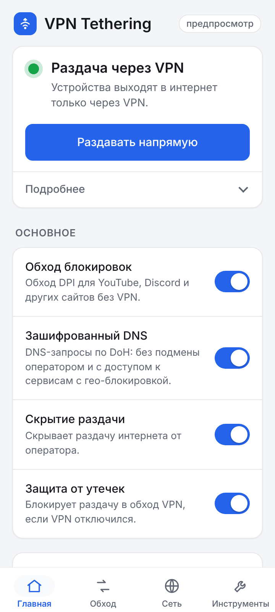
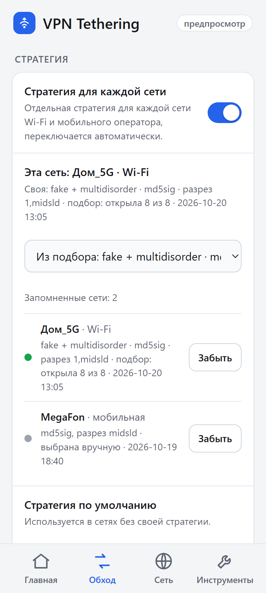
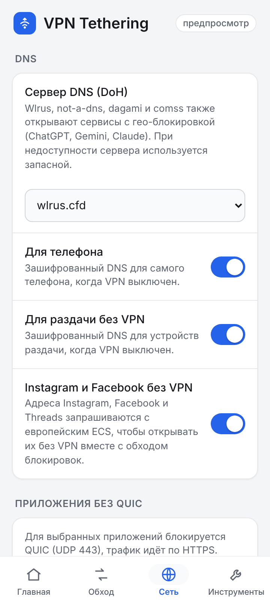
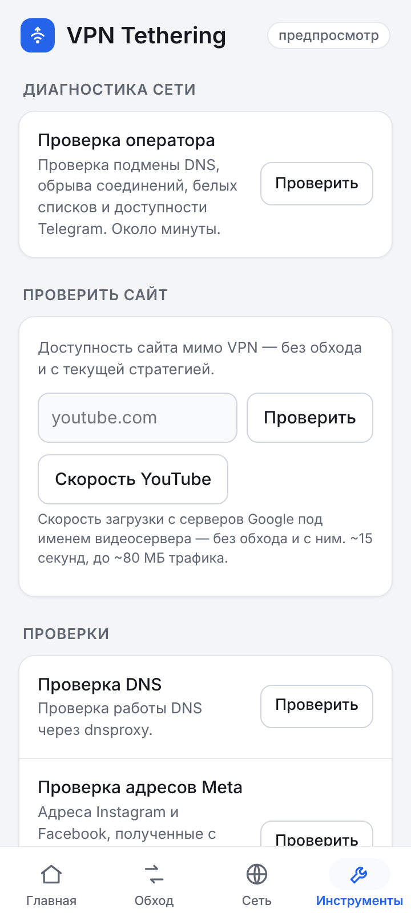

<div align="center">

# VPN Tethering Ultra

**Раздача Wi-Fi и USB через VPN телефона или напрямую — с защитой от утечек,
зашифрованным DNS и обходом блокировок.**

Модуль для KernelSU, Magisk и APatch.

[](https://github.com/JagKubarev/vpn-tethering-ultra/releases/latest)
[](LICENSE)
[](https://kernelsu.org/)
[](https://github.com/topjohnwu/Magisk)
[](https://github.com/bmax121/APatch)
[](#совместимость)

[Скачать](https://github.com/JagKubarev/vpn-tethering-ultra/releases/latest) ·
[Telegram](https://t.me/kubarev_mods) ·
[Чат](https://t.me/+LyVq9jqT-802MGIy) ·
[4PDA](https://4pda.to/forum/index.php?showtopic=1097835) ·
[Все настройки](docs/settings.md) ·
[История изменений](CHANGELOG.md) ·
[English](#english)

</div>

---

Модуль `vpn-to-hotspot-usb` раздаёт интернет телефона по Wi-Fi-точке и USB-модему так, чтобы
подключённые устройства выходили в сеть **через VPN-клиент телефона** или **напрямую через
оператора** — по выбору, одной кнопкой. Если VPN отключился, трафик раздачи не уходит мимо него.
В режиме «напрямую» DNS шифруется (DoH), а сайты, заблокированные через DPI, открываются
с помощью zapret/nfqws. Всё настраивается в WebUI, без правки файлов.

## Скриншоты

<p align="center">
<picture><source media="(prefers-color-scheme: dark)" srcset="docs/screenshots/home-dark.png"></picture>
<picture><source media="(prefers-color-scheme: dark)" srcset="docs/screenshots/bypass-dark.png"></picture>
<picture><source media="(prefers-color-scheme: dark)" srcset="docs/screenshots/net-dark.png"></picture>
<picture><source media="(prefers-color-scheme: dark)" srcset="docs/screenshots/tools-dark.png"></picture>
</p>
<p align="center"><sub>Главная · Обход · Сеть · Инструменты</sub></p>

## Возможности

- **Раздача через VPN или напрямую.** Клиенты Wi-Fi-точки и USB-модема выходят в интернет
  через туннель VPN-клиента телефона (NAT в `tun*`) или напрямую. Переключение — кнопкой
  Action или из WebUI; после перезагрузки включён режим VPN.
- **Защита от утечек.** Kill-switch по принципу fail-closed: если правила VPN не встали или
  их снесла система, трафик клиентов отбрасывается, а не уходит с реальным IP. Сторож правил
  восстанавливает их, аппаратный и BPF tethering offload отключается, при смене режима
  сбрасываются только соединения раздачи.
- **Зашифрованный DNS.** В режиме «напрямую» DNS клиентов и самого телефона идёт через
  dnsproxy по DoH — без подмены ответов оператором и с доступом к сервисам с гео-блокировкой
  (ChatGPT, Gemini, Claude и т. п.).
  Проверка здоровья, цепочка запасных серверов, адреса Instagram и Facebook «как из Европы» (ECS).
- **Обход блокировок (zapret/nfqws)** для трафика мимо VPN — раздачи напрямую и приложений
  телефона. Своя стратегия для каждой сети, подбор в WebUI (~2 или ~7 мин), сторож, который
  сам чинит сломавшуюся стратегию, отдельные стратегии для отдельных сайтов. Банки и Госуслуги
  обход не трогает никогда.
- **WARP без VPN-клиента.** Для того, что обход не открывает (Telegram, сайты с блокировкой
  по IP или по стране), — свой туннель WARP на AmneziaWG в режиме «напрямую». Через него идут
  только выбранные группы: Telegram (клиенты на телефоне — целиком), по желанию Google, свои
  домены и приложения телефона. Конфиги создаются прямо с телефона или импортируются из
  AmneziaVPN; перестал отвечать — модуль переходит на следующий.
- **YouTube на мобильном интернете.** Отбой «молчащих» видеосерверов, обрыв медленных
  видеосоединений, чтобы плеер ушёл на быстрый сервер, отдельная стратегия для YouTube,
  по желанию — отбой кэшей оператора (GGC), замер «Скорость YouTube».
- **Скрытие раздачи и удобство.** `noprovisioning` и TTL 63, закрытие QUIC выбранным
  приложениям, состояние модуля прямо в списке модулей, WebUI с проверками и журналами,
  обновление через менеджер модулей.

Подробно о каждой функции и все ключи конфига — в [справочнике](docs/settings.md).

## Совместимость

| | |
|---|---|
| Root | **KernelSU**, **Magisk**, **APatch** (учтены пути модулей `/data/adb/modules` и `/data/adb/ap`) |
| Архитектура | arm64 или armv7 — при установке остаются бинарники под устройство |
| Ядро | `iptables`/`ip6tables`, NFQUEUE (для обхода DPI) и conntrack; без `connbytes` обход работает в упрощённом режиме (модуль проверяет ядро при старте); IPv6 NAT не обязателен — без него DNS телефона перехватывается только по IPv4 |
| VPN | любой VPN-клиент, который поднимает `tun*` (проверялись AmneziaWG/WARP, VLESS-клиенты на sing-box, в том числе два tun одновременно) |
| Раздача | Wi-Fi-точка и USB-модем (в том числе CDC-NCM); клиенты — ноутбуки и ПК (Windows 7/10/11 и др.), другие телефоны |
| Проверено | Snapdragon (SM8750, Android 15), MediaTek; у пользователей — MTK (`ccmni*`), Samsung Exynos (`swlan0`) |

Соединения известных VPN-клиентов (список `VPN_CLIENT_PKGS` в `service.sh`) обход DPI не трогает,
чтобы не ломать переподключение. Если на телефоне стоит AdGuard с HTTPS-фильтром, модуль
исключает трафик dnsproxy из его перехвата (по GID). DNS-защиту AdGuard вместе с `DNS_PHONE=1`
не включайте: они будут перехватывать DNS друг у друга. Приложения, которые фильтрует AdGuard,
идут по TCP мимо WARP (AdGuard открывает соединение от своего имени) — чтобы приложение шло
через WARP целиком, исключите его в AdGuard.

Конфиги WARP хранятся в `/data/adb/vpn_tether_warp`. В файлах, которые сохраняет WebUI
(«Сохранить», «Сохранить все в zip» — в «Загрузки»), лежит закрытый ключ: его видят приложения
с доступом к памяти — не публикуйте такие файлы и удаляйте их после переноса.

## Установка

1. Скачайте `VPN_Tethering_Ultra_vX.Y.Z.zip` со страницы
   [последнего релиза](https://github.com/JagKubarev/vpn-tethering-ultra/releases/latest).
2. Установите zip через менеджер KernelSU, Magisk или APatch и перезагрузите телефон.
3. Включите раздачу Wi-Fi или USB как обычно. Режим переключается кнопкой **Action** у модуля,
   настройки — в **WebUI**. В KernelSU и APatch WebUI открывается из менеджера, в Magisk —
   через отдельное приложение для WebUI модулей (например, WebUI X).

При первой установке создаётся `/data/adb/vpn_tether.conf` с закомментированными примерами.
При обновлении модуля этот файл не трогается — настройки сохраняются.

### Обновление

Модуль поддерживает обновление через менеджер модулей: в `module.prop` указан `updateJson`,
и менеджер сам покажет новую версию со списком изменений
([`update-changelog.md`](update-changelog.md)). Можно и вручную — установить zip новой версии
поверх старой.

### Сборка из исходников

```sh
git clone https://github.com/JagKubarev/vpn-tethering-ultra.git
cd vpn-tethering-ultra/module && zip -r ../vpn-tethering-ultra.zip .
```

В корне архива должны оказаться `module.prop`, `service.sh`, `META-INF/`, `lib/`, `bin/`,
`zapret/`, `webroot/` и остальное содержимое папки `module/`.

## Управление

- **Action** (кнопка ▶ у модуля в менеджере) переключает VPN ↔ напрямую. Демон подтверждает
  переключение, и Action показывает статус: где идёт раздача, режим, DNS раздачи и телефона,
  kill-switch.
- **WebUI** — основное место для настроек: вкладки Главная, Обход, Сеть, WARP, Сервис. Кнопка
  «Применить» перечитывает настройки без перезагрузки и без обрыва соединений клиентов, если
  не менялись DNS или kill-switch.
- **Конфиг** `/data/adb/vpn_tether.conf` — те же настройки в виде `КЛЮЧ=значение`. Файл
  не исполняется: читаются только известные ключи, каждое значение проверяется.

Таблица всех ключей, устройство обхода DPI и DNS, файлы модуля на устройстве —
в [docs/settings.md](docs/settings.md).

## Вопросы и ответы

**Чем режим «напрямую» отличается от обычной раздачи?**
Клиенты идут в интернет без VPN, но их DNS шифруется через DoH, а сайты из списков открываются
через обход DPI. Если обход или свой DNS не нужны, их можно выключить на Главной.

**Помогает ли обход от любой блокировки?**
Нет. zapret работает против блокировок по имени сайта (SNI). Против блокировок по IP-адресу
он не помогает — для таких сайтов нужен VPN. Обход действует только на трафик мимо VPN:
туннель и соединения VPN-клиентов модуль не трогает.

**Ноутбук на Windows не выходит в интернет при включённом строгом TTL.**
`TETHER_TTL_STRICT=1` отбивает пакеты с «чужим» TTL, а у Windows он 127. Выключите эту опцию
или настройте TTL на самом устройстве. По умолчанию она выключена.

**VPN-клиент маршрутизирует по доменам (fakeip), а через раздачу сайты не открываются.**
Оставьте `DNS_VPN=dnat` (по умолчанию): тогда DNS раздачи идёт в DNS самого VPN-клиента.

**Слетят ли настройки при обновлении?**
Нет. Конфиг, свои списки сайтов и стратегии сетей лежат в `/data/adb/` вне папки модуля.

**Где логи?**
Основной лог — `/data/local/tmp/vpn_tether.log` (прошлый запуск — `vpn_tether.log.prev`),
сообщения дублируются в logcat с тегом `vpn_tether`. Хвост лога виден во вкладке «Сервис»,
там же кнопка «Отправить логи». С вопросами и логами — в [чат](https://t.me/+LyVq9jqT-802MGIy) или
в [Issues](https://github.com/JagKubarev/vpn-tethering-ultra/issues) (см. [Связь](#связь)).

## Связь

- [Telegram-канал](https://t.me/kubarev_mods) — новые версии и новости.
- [Чат](https://t.me/+LyVq9jqT-802MGIy) — вопросы, обсуждение, помощь с настройкой.
- [Issues](https://github.com/JagKubarev/vpn-tethering-ultra/issues) — сообщения об ошибках.
  Приложите файл из «Сервис → Отправить логи» и укажите версию модуля, менеджер
  (KernelSU / Magisk / APatch) и VPN-клиент.
- [4PDA, каталог модулей](https://4pda.to/forum/index.php?showtopic=1097835) — релизы.

## Версии

Нумерация `X.Y.Z`: **X** — этап, **Y** — заметная функция, **Z** — исправления.
`versionCode` = X·10000 + Y·100 + Z (3.8.1 → 30801). До 23.10.2026 у модуля было две
нумерации (внешняя 2.x и внутренняя 3.x-hybrid) — таблица соответствия в [`CHANGELOG.md`](CHANGELOG.md).
Теги `v1.0` … `v3.19.0`; подробности — в начале `module/service.sh` и в `CHANGELOG.md`.

<details>
<summary>Кратко по версиям</summary>

**0.x — до репозитория (апрель–август 2026):** прототип и первые сборки на 4PDA (0.1–0.5),
ветка 0.6–0.7.3, стабильная база hybrid 0.8 и kill-switch 0.9.

**1.x — основа и свой DNS (13–19.10)**

| Версия | Главное |
|---|---|
| 1.0 | База: раздача через VPN с fail-closed kill-switch, сторожем правил, строгим режимом, определением раздачи/WAN по правилам netd, адресным сбросом conntrack. |
| 1.1 | Свой DNS для раздачи через dnsproxy (DoH) в режиме «напрямую», опции `DNS_VPN` cache/doh; 1.1.1–1.1.3 — DoH рядом с AdGuard, без окна DNS оператора, защита порта и в IPv6. |
| 1.2 | `DNS_PHONE`: DoH и для самого телефона, когда VPN не поднят. |
| 1.3 | Проверка здоровья DoH с откатом на обычный DNS, BBR без cubic, проверки только при использовании DNS. |
| 1.4 | Понятный вывод Action, состояние в описании модуля, `DNSPROXY_ENABLE`, конфиг `/data/adb/vpn_tether.conf`; 1.4.2 — `QUIC_BLOCK_APPS`. |

**2.x — WebUI и обход DPI (19–20.10)**

| Версия | Главное |
|---|---|
| 2.0 | WebUI (`webroot/`, `webctl.sh`), «Применить» без перезагрузки. |
| 2.1 | Обход DPI: zapret/nfqws для трафика мимо VPN, встроенный список, закрытие QUIC. |
| 2.2 | Сканер `zapret/scan.sh`: подбор стратегии и «Проверить сайт» в WebUI; 2.2.1 — по умолчанию `fakeddisorder` (проверено в 10 сетях). |
| 2.3 | Своя стратегия zapret для каждой сети; DNS Meta «как из Европы»; 2.3.1 — закрыта утечка через BPF tethering offload (Android 13+); 2.3.2–2.3.3 — встроенный список 47 → 196 доменов; 2.3.4 — zapret на мобильном интернете (Qualcomm стирал метку nfqws). |
| 2.4 | `YT_GGC_BLOCK`, запасные DoH вместо DNS оператора, облегчённый цикл, «Скорость YouTube»; 2.4.1 — GGC выключен по умолчанию. |

**3.x — YouTube и автоподстройка (21–23.10)**

| Версия | Главное |
|---|---|
| 3.0 | Отбой мёртвых видеосерверов, сторож обхода, подбор с большим ClientHello. |
| 3.1 | Удержание запасных DNS (без «дёрганья»), стратегия сети по названию, сторож перепроверяет перед заменой. |
| 3.2 | `TETHER_STEALTH` / `TETHER_TTL_STRICT` — скрытие раздачи вместо отдельного модуля. |
| 3.3 | Новые умолчания (обход и Meta вкл., строгий kill-switch выкл.), новая цепочка запасных DoH. |
| 3.4 | Отдельная стратегия для YouTube, список исключений (банки, Госуслуги), приманки с российским SNI, «Диагностика сети»; 3.4.1 — новый порядок DoH по умолчанию. |
| 3.5 | Отбой мёртвых серверов точнее (/32, /24 только при двух), фоновая перепроверка; срок 20 → 10 мин. |
| 3.6 | Своя стратегия для отдельных сайтов (`ZAPRET_ALT`), новые приёмы nfqws в подборе (`--dup`, `--orig-autottl`, `--wssize`, syndata). |
| 3.7 | Обрыв медленных видеосоединений (`YT_SLOW_RETRY`, `ytslow.sh`); 3.7.1–3.7.3 — обрыв «догнанных» быстрых соединений, надёжнее плановая проверка сайтов; 3.7.4 — исправления по ревью облачных сессий. |
| 3.8 | Зоны `.ru`/`.su`/`.рф` мимо обхода и автосписка, кроме сайтов из встроенного и своего списка; 3.8.1 — одна нумерация версий, лицензии. |
| 3.9 | Видно, почему сайт попал в автосписок (дата, сбросы/зависания/редирект, телефон или раздача), удаление одного домена, порог `ZAPRET_AUTO_FAIL`. |
| 3.10 | WebUI по вкладкам: главные выключатели на Главной, «Отправить логи», доводка оформления; функции `service.sh` вынесены в `module/lib/` без изменения поведения. |
| 3.10.1 | WebUI: проверки в фоне без зависаний, без растягивания при прокрутке; «Отправить логи» работает с Telegram, в подписи время. |
| 3.11 | Обновление через менеджер модулей (`update.json`, релизы на GitHub), тексты Action без эмодзи, «Модуль запускается» при загрузке, нижняя панель WebUI как в MAX. |
| 3.11.1 | Исправления: статус при загрузке без раздачи и VPN, автосписок не стирает неприменённые сайты, сброс pid при загрузке. |
| 3.11.2 | DNS: первый запасной DoH — dagami; в откате проверяется и основной DoH — возврат на него без ожидания запасных. |
| 3.12 | Первый публичный релиз: новое описание репозитория, справочник настроек в `docs/settings.md`; список DNS в WebUI в порядке запасных. |
| 3.13–3.15.1 | Telegram и сайты без VPN через прокси Opera (убрано в 3.16); эвристика раздачи не путает клиент Wi-Fi с точкой доступа; WebUI без рамки фокуса у вкладок. |
| 3.16 | Прокси Opera убран целиком (работал нестабильно), поведение как в 3.12 с исправлениями 3.13–3.14; хвосты старых версий убираются при старте. |
| 3.17 | Отбой молчащих серверов и для загрузок Play Маркета (`gvt1.com`); новый вид «молчит после запроса» — с фоновой проверкой адреса перед отбоем. Google и Cloudflare убраны из запасных DoH (не обходят гео-блок); кнопка «Сбросить кэш DNS» и сброс при возврате на DoH. |
| 3.18 | Устройства в раздаче с блокировкой по MAC, пауза обхода в белых списках, тип блокировки в «Проверить сайт» (отдельно не выпускалась — вошла в 3.19.0). |
| 3.19.0 | WARP (AmneziaWG) в режиме «напрямую»: группы Telegram/Google/домены/приложения, клиенты Telegram целиком, конфиги с телефона и из AmneziaVPN, переход на следующий конфиг; проверка ядра для zapret и упрощённый режим без `connbytes`; bbr3; вкладка «Сервис». |

</details>

## Благодарности и сторонние компоненты

Модуль опирается на работу других открытых проектов. В `module/bin/` лежат их готовые
бинарники, лицензии и источники — рядом (`*.LICENSE`, `*.SOURCE`, с sha256 исходных архивов).

| Компонент | Версия | Проект | Лицензия |
|---|---|---|---|
| `nfqws` | из zapret v72.13 | [bol-van/zapret](https://github.com/bol-van/zapret) | MIT ([`nfqws.LICENSE`](module/bin/nfqws.LICENSE)) |
| `dnsproxy` | v0.86.0 | [AdguardTeam/dnsproxy](https://github.com/AdguardTeam/dnsproxy) | Apache-2.0 ([`dnsproxy.LICENSE`](module/bin/dnsproxy.LICENSE)) |
| `conntrack` | v1.4.8 (статическая сборка) | conntrack-tools, [netfilter.org](https://www.netfilter.org/projects/conntrack-tools/) | GPL-2.0 ([`conntrack.LICENSE`](module/bin/conntrack.LICENSE); рецепт сборки — [`conntrack.SOURCE`](module/bin/conntrack.SOURCE), исходники — [`third_party/conntrack/`](third_party/conntrack/)) |
| `amneziawg-go` | v3.1.20260828 | [amnezia-vpn/amneziawg-go](https://github.com/amnezia-vpn/amneziawg-go) | MIT ([`amneziawg-go.LICENSE`](module/bin/amneziawg-go.LICENSE); Go — [`golang.LICENSE`](module/bin/golang.LICENSE)) |
| `awg` | из amneziawg-tools v3.1.20260812 | [amnezia-vpn/amneziawg-tools](https://github.com/amnezia-vpn/amneziawg-tools) | GPL-2.0 ([`awg.LICENSE`](module/bin/awg.LICENSE); сборка — [`amneziawg.SOURCE`](module/bin/amneziawg.SOURCE), исходники — [`third_party/amneziawg/`](third_party/amneziawg/)) |

Спасибо авторам zapret (bol-van), dnsproxy (AdGuard), AmneziaWG (Amnezia) и netfilter. Некоторые идеи подбора
стратегий взяты из ZDT-D, byedpi (`--auto`) и zapret2 (circular), как указано в журнале
изменений. Спасибо участникам темы на 4PDA за тесты на своих устройствах и сетях.

## Структура репозитория

| Путь | Что там |
|---|---|
| [`module/`](module/) | Сам модуль — из этой папки собирается zip |
| [`docs/settings.md`](docs/settings.md) | Справочник: все настройки, устройство обхода DPI и DNS, файлы и логи |
| [`docs/screenshots/`](docs/screenshots/), [`docs/webui/`](docs/webui/) | Скриншоты WebUI |
| [`third_party/conntrack/`](third_party/conntrack/), [`third_party/amneziawg/`](third_party/amneziawg/) | Исходники `conntrack` и AmneziaWG (GPL), в модуль не входят |
| [`tools/`](tools/) | Стенды и скрипты замеров для разработки, в модуль не входят |
| [`CHANGELOG.md`](CHANGELOG.md) | Полная история изменений |
| [`update.json`](update.json), [`update-changelog.md`](update-changelog.md) | Обновление через менеджер модулей |

## Лицензия

Код модуля (скрипты, WebUI, списки, `tools/`) — **GPL-3.0**, © Kubarev, текст в [`LICENSE`](LICENSE)
(копия — [`module/LICENSE`](module/LICENSE), попадает в zip). Изменённые версии можно
распространять только под той же лицензией, с исходниками и с сохранением авторства.
Сторонние бинарники в `module/bin/` идут под своими лицензиями (см. таблицу выше).

---

## English

**VPN Tethering Ultra** (`vpn-to-hotspot-usb`) is a KernelSU / Magisk / APatch module for rooted
Android (arm64 / armv7). It shares the phone's connection over Wi-Fi hotspot and USB tethering
either **through the phone's VPN** (NAT into `tun*`) or **directly**, switchable with the module's
**Action** button or from the WebUI.

It provides a fail-closed **kill-switch** with a rule watchdog and removes hardware/BPF tethering
offload that could leak traffic past the VPN; **encrypted DNS** via dnsproxy (DoH) for tethered
clients and the phone itself, with health checks, an ordered fallback chain and EU-located answers
for Meta domains (ECS); **DPI circumvention** with zapret's `nfqws` for traffic outside the VPN —
per-network strategies, a quick/full strategy scanner, a self-repairing watchdog, per-site
strategies and an exclusion list for banks and government services; a built-in **WARP tunnel**
(AmneziaWG, no VPN app needed) for selected groups — Telegram, Google, custom domains, whole apps —
with configs generated on the phone or imported from AmneziaVPN; **YouTube helpers** for mobile
networks (fail-fast on silent video servers, dropping slow video connections); tethering stealth
(TTL 63) and per-app QUIC blocking.

Download the zip from [Releases](https://github.com/JagKubarev/vpn-tethering-ultra/releases/latest),
install it in your root manager and reboot; later updates arrive through the manager. Everything is
configured in the WebUI or in `/data/adb/vpn_tether.conf` (`KEY=value`, validated, never executed).
The main log is `/data/local/tmp/vpn_tether.log` (logcat tag `vpn_tether`). News: [Telegram channel](https://t.me/kubarev_mods);
questions: [chat](https://t.me/+LyVq9jqT-802MGIy); bug reports: [Issues](https://github.com/JagKubarev/vpn-tethering-ultra/issues). The interface and
documentation are in Russian; the full reference is [docs/settings.md](docs/settings.md).

The module's own code is licensed under **GPL-3.0**. Bundled third-party binaries: `nfqws` from
[zapret](https://github.com/bol-van/zapret) v72.13 (MIT), [dnsproxy](https://github.com/AdguardTeam/dnsproxy)
v0.86.0 (Apache-2.0), `conntrack` v1.4.8 from conntrack-tools (GPL-2.0), [amneziawg-go](https://github.com/amnezia-vpn/amneziawg-go)
(MIT) and `awg` from amneziawg-tools (GPL-2.0); GPL sources are in `third_party/`.
